# Fabric Data Mesh — Domains · OneLake Shortcuts · Purview Governance (Terraform)

[](https://github.com/felipecastro-data/fabric-domain-architecture-purview-governance/actions/workflows/ci.yml)
[](https://github.com/felipecastro-data/fabric-domain-architecture-purview-governance/actions/workflows/terraform.yml)
[](https://github.com/felipecastro-data/fabric-domain-architecture-purview-governance/actions/workflows/compliance.yml)
[](LICENSE)

A **data-mesh architecture on Microsoft Fabric**, governed end to end and **defined as code**. Fabric **domains** own
their workspaces. Producer domains publish **data products** through **OneLake shortcuts**, with zero copies. A
consumer domain combines them across domains. **OneLake data access roles**, **Microsoft Purview sensitivity labels**,
**endorsement**, **tags** and **lineage** decide who reads what and which data can be trusted. A daily **compliance check** proves the live tenant still matches the code.

The data products expose real Chicago **Divvy** bike-share trips and **Open-Meteo** weather. The sibling project
[fabric-medallion-cicd-terraform](https://github.com/felipecastro-data/fabric-medallion-cicd-terraform) produces that
data. This repository adds the mesh and the governance on top, without moving a single row.

| At a glance | |
|---|---|
| Domains | **3 Fabric domains**: Mobility and Weather (producers), Analytics (consumer). Each has an owners, engineers and consumers Entra group. |
| Data products | **12 OneLake shortcuts**, **0 copies**. `fact_trips` (**6.0M rows**) is read through 2 shortcut hops from the prod medallion lakehouse. Analytics serves its own product: a **Direct Lake semantic model** of demand against weather. |
| Access | **6 OneLake security roles**. Consumers read dimensions and aggregates only; ride-level data is for engineers. Verified live as a consumer test user. |
| Governance | Sensitivity labels, tags, endorsement and domain contributor scope for every data product, all declared in Terraform. An **ODCS v3.1 data contract** per product (schema, owners, freshness SLA, classification). |
| As code | **57 Terraform resources** in 2 stacks, plus **5 idempotent Python tools** for what the provider can't manage. |
| Delivery | **dev → prod**: every change is applied to `mesh-*-dev` (on `divvy-medallion-dev`) and checked before an approval releases it to prod. GitHub OIDC (no secrets), a plan comment per stack and environment on every PR, and a required **compliance** check that also runs daily. |

## Architecture

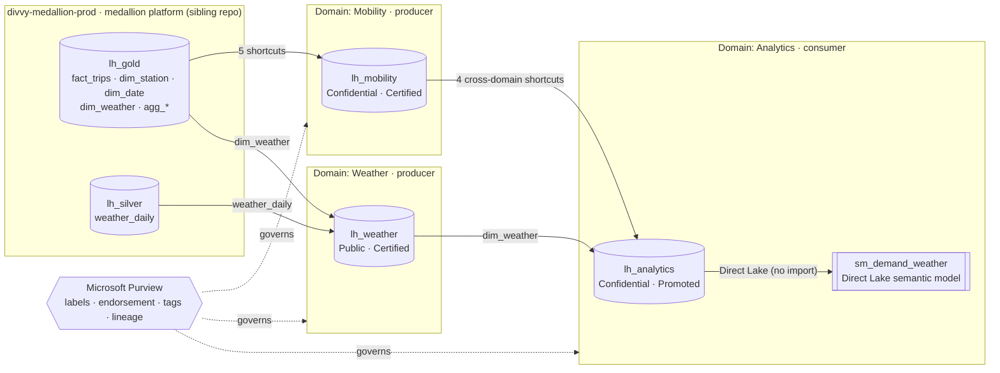

Every data product lakehouse holds **only shortcuts**. The data stays in the medallion platform's prod workspace, and
the mesh adds ownership, discoverability and access control on top of it.

### Ownership: two Terraform stacks

```mermaid
flowchart LR
    subgraph GOV["infra/terraform/governance · central governance (tenant scope)"]
        GR["9 Entra groups<br/>owners · engineers · consumers"]
        DO["3 domains + default labels"]
        DR["Domain admins / contributors"]
        TG["4 tenant tags"]
    end
    subgraph DOM["infra/terraform/domains · domain platform teams"]
        WS["Workspaces + data product lakehouses"]
        SC["12 shortcuts"]
        RA["Workspace roles · domain assignment · tags"]
        OR["OneLake role map"]
    end
    HCP[("HCP Terraform<br/>remote state")]
    GOV -- outputs --> HCP -- terraform_remote_state --> DOM
    DOM -- "terraform output" --> T["fabric_mesh_tools<br/>roles · labels · endorsement check"]
```

The central stack is applied first. Domain teams consume its outputs (domain IDs, group IDs, label IDs, tag IDs) and
never touch tenant-scope resources.

## Features

- **Data mesh on Fabric domains**: each domain owns its workspace, its data product lakehouse and three Entra groups
  (owners, engineers, consumers), mapped to domain roles and workspace roles in Terraform.
- **Zero-copy data products**: data product lakehouses hold only OneLake shortcuts. Producers point at the prod
  medallion lakehouses, and the consumer domain points at the producers, so every read hits the original Delta files.
- **A consumer product that serves**: Analytics builds `sm_demand_weather`, a Direct Lake semantic model over its
  shortcuts: relationships and measures (trips per wet and dry day, a weather-adjusted demand index) with no import
  and no copy. CI frames it after every apply and checks the framing daily; run as a user, the same tool checks every measure with a DAX query.
- **Least-privilege access across hops**: OneLake security roles restrict tables at the source, and passthrough
  shortcuts make access the intersection of every hop. Consumers get dimensions and aggregates; ride-level data is for
  engineers only. A Terraform validation blocks roles on shortcut paths, which Fabric rejects.
- **Purview governance as data**: a sensitivity label, tags, an endorsement level and a domain default label for every
  data product, declared once in Terraform and applied or checked by tools.
- **Restricted domain contributors**: only a domain's engineers group can add workspaces to it, instead of the default
  "entire tenant".
- **Lineage for free**: because the data is never copied, Fabric lineage shows each data product all the way back to
  the medallion platform.
- **Two-stack ownership**: a central governance stack (tenant scope) and a domain platform stack that reads its outputs
  from HCP Terraform remote state, so domain changes can't touch tenant settings.
- **Idempotent tools for API gaps**: dry run by default, exit 1 on drift, `--apply` to fix. They cover OneLake roles,
  labels, contributor scope and tenant settings until the provider catches up.
- **Data contracts**: one [ODCS v3.1](https://bitol-io.github.io/open-data-contract-standard/) contract per data
  product in [`contracts/`](contracts). Every day CI reads each table through its product lakehouse and fails on a
  missing or retyped column, an empty table, or a shortcut chain that doesn't end in `divvy-medallion-prod`. A
  separate job alerts when a product is older than its 8-day freshness SLA.
- **Environment promotion**: the domains stack runs as dev (`mesh-<domain>-dev`, reading `divvy-medallion-dev`) and
  prod, each with its own HCP state. CI applies dev and checks it (roles, labels, contracts) before prod is offered for
  approval. Tenant-scope governance is shared and gets its own approval.
- **Delivery with gates**: GitHub OIDC (no cloud secrets), a plan comment per stack and environment on every PR, an
  approval-gated prod apply, a protected `main` and a required compliance check that also runs after every apply and
  daily.

## Governance matrix

| Domain | Kind | Data product | Sensitivity label | Tags | Endorsement | OneLake roles |
|---|---|---|---|---|---|---|
| Mobility | producer | `lh_mobility` | **Confidential** | Data Product · Source Aligned · Contains Ride Data | ✅ **Certified** | `CrossDomainRead` (Analytics) |
| Weather | producer | `lh_weather` | **Public** | Data Product · Source Aligned | ✅ **Certified** | `CrossDomainRead` (Analytics) |
| Analytics | consumer | `lh_analytics` | **Confidential** | Consumer Aligned · Contains Ride Data | ⭐ **Promoted** | Built-in `DefaultReader` |

Each domain has a **default sensitivity label**, so new items are labelled on creation. Domain contributors are
restricted to the domain's engineers group (`SpecificUsersAndGroups`, not the default "entire tenant").

## Access model

| Group (per domain) | Domain role | Workspace role | Data access |
|---|---|---|---|
| `sg-mesh-<domain>-owners` | Admin | Admin | Everything in the domain's workspace |
| `sg-mesh-<domain>-engineers` | Contributor | Contributor | Everything in the domain's workspace; Mobility and Analytics engineers also read ride-level data upstream |
| `sg-mesh-<domain>-consumers` | — | Viewer | Only the tables a OneLake security role grants |

OneLake shortcuts are **passthrough**: a reader needs a role **at every hop**, and effective access is the
**intersection**. Fabric rejects roles on shortcut paths, so the mesh lakehouses grant `*` to cross-domain readers,
and table-level restrictions live on the source lakehouses where the data is. A Terraform validation enforces
that rule.


| Role | Lakehouse | Tables | Granted to |
|---|---|---|---|
| `CrossDomainRead` | `lh_mobility` | `*` (passthrough) | analytics consumers, analytics engineers |
| `CrossDomainRead` | `lh_weather` | `*` (passthrough) | analytics consumers, analytics engineers |
| `MeshAggregates` | divvy-prod `lh_gold` | dim_station, dim_date, agg_daily_kpis, agg_station_monthly | mobility consumers, analytics consumers |
| `MeshRideLevel` | divvy-prod `lh_gold` | **fact_trips** + the 4 above | mobility engineers, analytics engineers |
| `MeshWeather` | divvy-prod `lh_gold` | dim_weather | weather and analytics, consumers and engineers |
| `MeshWeather` | divvy-prod `lh_silver` | weather_daily | weather consumers, weather engineers |

### Verified as a real consumer

A test user whose only access is membership of `sg-mesh-analytics-consumers` (no Fabric license) read the
Analytics lakehouse over OneLake. Each read went through `lh_analytics` → producer lakehouse → `lh_gold`:

| Table | Path | Result |
|---|---|---|
| `agg_daily_kpis` | 2 hops | ✅ 732 rows |
| `dim_station` | 2 hops | ✅ 2,028 rows |
| `dim_weather` | 2 hops | ✅ 365 rows |
| `fact_trips` | 2 hops | ⛔ denied ("lacked the necessary privileges") |

Analytics engineers hold a role at every hop and read all 6,006,901 rows of `fact_trips`. Membership of an owners
group alone does not: workspace Admin applies only in the domain's own workspace, not at upstream hops.
[`read_onelake.py`](src/fabric_mesh_tools/read_onelake.py) reproduces the test.

## Delivery

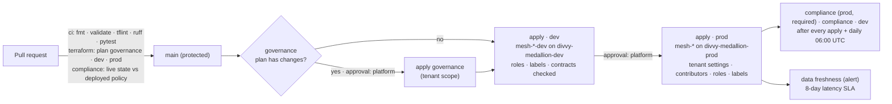

- **No secrets**: the CI service principal signs in with GitHub OIDC federated credentials. The HCP Terraform token
  is the only repository secret.
- **A dedicated CI identity**: one service principal for this repo. It gets Fabric admin APIs through a single
  automation group and is Admin of only the mesh workspaces, through their owners groups. It is Member of the source
  workspace, which OneLake security management requires. Its Graph permissions (`Group.ReadWrite.All`,
  `Directory.Read.All`) are tenant-wide, because Graph has no per-group application scope; Terraform only manages the
  9 mesh groups.
- **`main` is protected**: changes land through PRs only, `ci` and `compliance` are required, and review threads must be resolved.
- **Compliance** fails the build when any of these drifts from Terraform: a workspace's domain, a tenant setting, a
  domain's contributor scope, a OneLake role, a label, a tag set or an endorsement; or when a data product breaks its
  contract (schema, row counts, lineage). Freshness runs as a separate, non-required `data freshness` job.
- **Accepted trade-off: PR plans use the deployment identity.** Providers and data sources can run code during
  `terraform plan`, so a pull request from someone with write access could act with the CI service principal before
  the `platform` approval. Fork PRs never get the credentials: their plan and compliance jobs are skipped. With a
  single maintainer, one identity is a deliberate simplification. The fix for a larger team is a separate read-only
  service principal for plans, with Viewer workspace roles and read-only admin APIs, keeping the write identity
  behind the protected environment.

## What is code, and what isn't

| Concern | Managed by | How |
|---|---|---|
| Groups, domains, domain roles, default labels, tags | Terraform `governance` | `azuread_group`, `fabric_domain`, `fabric_domain_role_assignments`, `fabric_tag` |
| Workspaces, lakehouses, workspace roles, domain assignment, shortcuts, item tags | Terraform `domains` | `fabric_workspace`, `fabric_lakehouse`, `fabric_domain_workspace_assignments`, `fabric_shortcut` |
| Analytics semantic model (TMDL) | Terraform `domains` → [`semantic_model.py`](src/fabric_mesh_tools/semantic_model.py) | `fabric_semantic_model`; framing (CI) and a DAX check (users: `executeQueries` rejects service principals on Direct Lake on OneLake) through the Power BI REST API |
| OneLake security roles | Terraform role map → [`onelake_roles.py`](src/fabric_mesh_tools/onelake_roles.py) | Single-role upsert. The provider resource fails on Entra members ([#1044](https://github.com/microsoft/terraform-provider-fabric/issues/1044)). |
| Sensitivity labels on existing items | Terraform → [`data_product_governance.py`](src/fabric_mesh_tools/data_product_governance.py) | `bulkSetLabels` (user-only API, so CI only checks labels) |
| Domain contributor scope | [`domain_contributors.py`](src/fabric_mesh_tools/domain_contributors.py) | Admin API (`contributorsScope` is preview-only) |
| Tenant settings (labels, endorsement, domains) | [`tenant_settings.py`](src/fabric_mesh_tools/tenant_settings.py) | Admin API |
| Purview labels and label policy | [`purview/labels.ps1`](tools/purview/labels.ps1) | Security & Compliance PowerShell |
| Data contracts: schema, row counts, lineage, freshness | [`contracts/*.yml`](contracts) → [`data_contracts.py`](src/fabric_mesh_tools/data_contracts.py) | Delta log over OneLake (delta-rs) + shortcuts API; validated against the ODCS JSON schema |
| **Endorsement** | **Portal** (no write API exists) | Set once in item settings. Terraform declares it, and the compliance check fails while it differs. |

The Python tools are idempotent. Each runs as a dry run by default, exits 1 on drift, and makes changes only with
`--apply`. All of them except `tenant_settings.py` read their desired state from `terraform output`, so there is one
source of truth; `tenant_settings.py` keeps its own `DESIRED` map. `labels.ps1` is idempotent too, but it has no dry
run: it creates or updates the labels and publishes the label policy as soon as it runs.

## What the gates caught

Each of these was found by a plan, a failed apply, a live test or a review, before it could become silent drift.

| Found by | Problem | Fix |
|---|---|---|
| Terraform apply | `fabric_onelake_data_access_security` fails with "inconsistent result after apply" for Entra members; the API never returns `objectType` | Role map stays in Terraform, applied by a Python upsert tool until the provider fix ships |
| Fabric API | Table-level roles on shortcut paths are rejected (`defining roles for SSO shortcuts is not supported`) | Restrictions moved to the source lakehouses; Terraform validation blocks the pattern |
| API review | `PUT …/dataAccessRoles` replaces **all** roles on an item, including ones this repo doesn't own | Tool upserts one role at a time with `POST` and lists unmanaged roles instead of deleting them |
| Scanner check | A domain default label only applies to items created afterwards, so the existing lakehouses had no label | `bulkSetLabels` from the Terraform-declared label; SQL endpoints inherit it |
| Domain review | New domains let the **entire tenant** contribute workspaces | Contributor scope restricted to the engineers group; checked on every run |
| CI bootstrap plan | A provider update started tracking lakehouse `tags` and planned to strip the tags the tool had applied | Tags moved into Terraform; the tool now only checks them |
| Live consumer test | The Fabric REST API returns 401 `UserNotLicensed` for a license-free consumer, but OneLake reads work | Reader takes lakehouse GUIDs, so consumers are tested exactly as they read |
| Code review | A required compliance check would block policy-changing PRs and every fork PR | PRs check live state against the deployed policy (base-branch tools); fork PRs skip safely |
| Code review | A workspace created by CI already makes it Admin, so a direct Admin assignment would fail with `PrincipalAlreadyHasWorkspaceRolePermissions` | CI is a member of every owners group and inherits Admin through it |
| Code review | One workflow-wide concurrency group let a PR plan cancel a deployment waiting for approval | Plans queue per PR and stack; applies have their own group that never cancels |
| Code review | The plan-comment lookup read only the first page of PR comments, so busy PRs got duplicate comments | The lookup paginates over every comment |
| Security review | PR plans run with the deployment identity, and Terraform can run code during a plan | Accepted and documented for a single maintainer; fork PRs never get credentials (see [Delivery](#delivery)) |

## Results and impact

| | |
|---|---|
| **0 bytes copied** | 12 shortcuts serve **485 MB** of Delta data and **6.0M ride rows** in place. Every data product is as fresh as prod. |
| **Least privilege, proven live** | A license-free test consumer read 3 tables through 2 shortcut hops and was denied `fact_trips`. |
| **Drift caught daily** | 5 checks compare the live tenant with Terraform after every apply and at 06:00 UTC: workspace domains, tenant settings, contributor scope, OneLake roles, labels, tags and endorsement. |
| **Promotion without risk** | Adding environments planned **0 changes in prod**. Dev runs the same 32 resources against `divvy-medallion-dev` (1.6M trips) and must pass its contracts before prod can be approved. |
| **Clean deploys as CI** | Applies run as the service principal: governance, then domains, then 5 tools, all reporting a match. |
| **Fast feedback** | A no-change apply takes **9 s** (governance) and **14 s** (domains), plus **15 s** for the 5 tools. The daily compliance run takes **30–50 s**. |
| **Hops are free** | Reading all 6,006,901 rows of `fact_trips` took **13.0 s through 2 shortcut hops and 13.0 s from `lh_gold` directly** (median of 3). Zero-copy costs nothing at read time. |
| **A product that answers** | `sm_demand_weather` frames in **18 s** and answers its DAX check (run as a user) in **1.8 s**, reading Delta through 2 shortcut hops with no import. In dev (62 days, 1.6M trips), wet days averaged **23,208 trips** against **28,025** on dry days: **17.2 % lower demand**. Members took **61 %** of trips. |
| **Contracts enforced** | 3 ODCS contracts cover 12 tables. Every table is checked daily for schema, row count and a lineage chain that ends in `divvy-medallion-prod`. |
| **57 resources, one source of truth** | Groups, domains, workspaces, shortcuts, roles, the semantic model and governance metadata are declared once; tools read them from `terraform output`. |

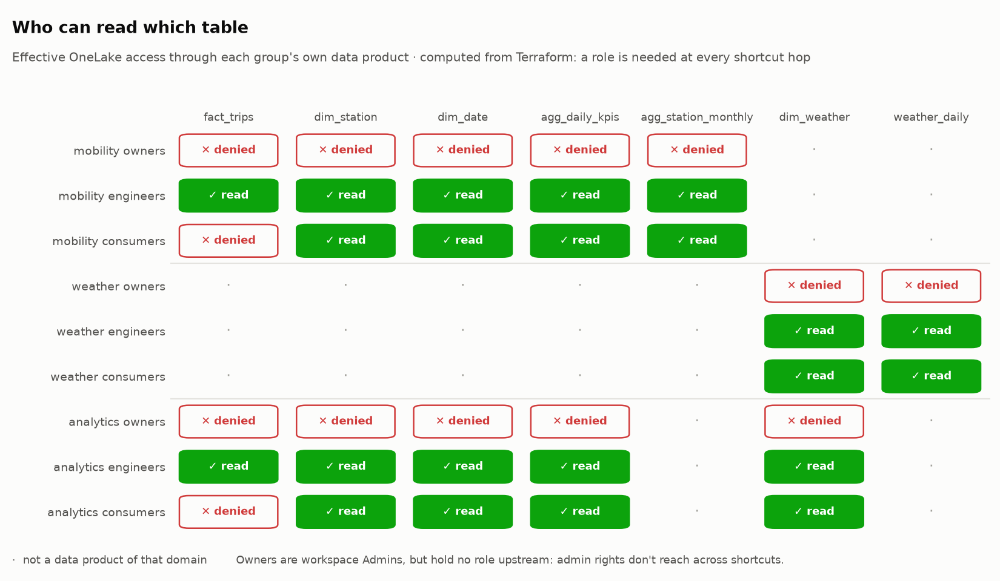

Owners are workspace Admins, yet they're denied every table: Admin applies only to the domain's own workspace, and
shortcuts need a role at every hop. Access to the data is granted on purpose, never inherited by accident.

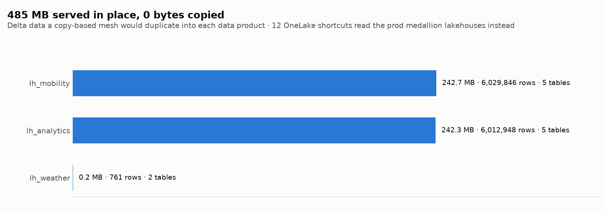

A copy-based mesh would store `fact_trips` twice more (once per domain that exposes it) and keep both copies in sync.
Shortcuts store nothing: the mesh adds governance, not storage or pipelines.

Both charts come from [`mesh_charts.py`](src/fabric_mesh_tools/mesh_charts.py). It computes access from the Terraform outputs
and reads table sizes from OneLake.

## Screenshots

### Lineage: data products without copies

| Mobility reads the medallion platform's prod lakehouse | Analytics combines both producer domains |
|---|---|
| 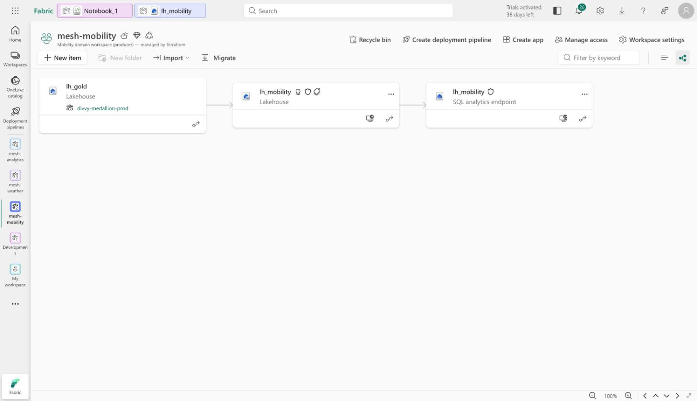 | 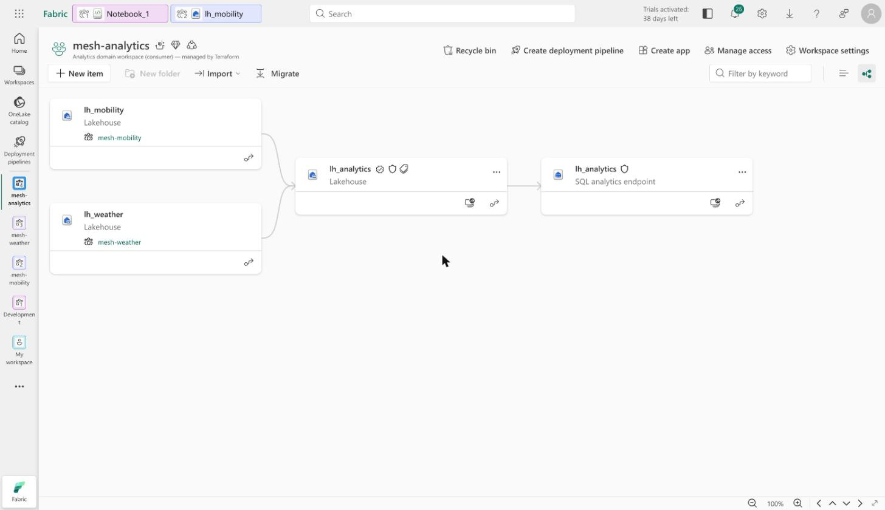 |

### Trust: labels and endorsement

| Mobility data product: Certified and Confidential | OneLake catalog: endorsed data products by domain |
|---|---|
| 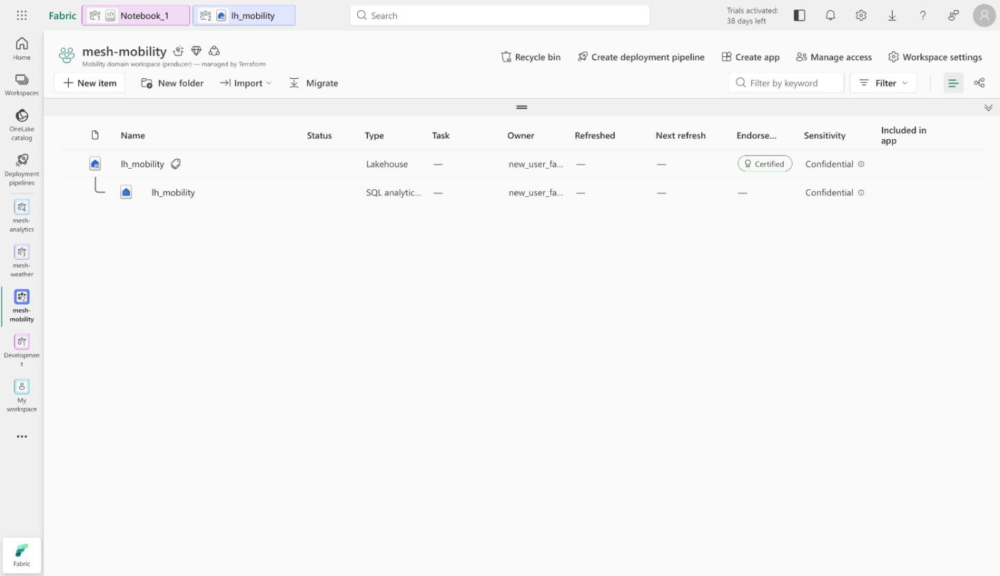 | 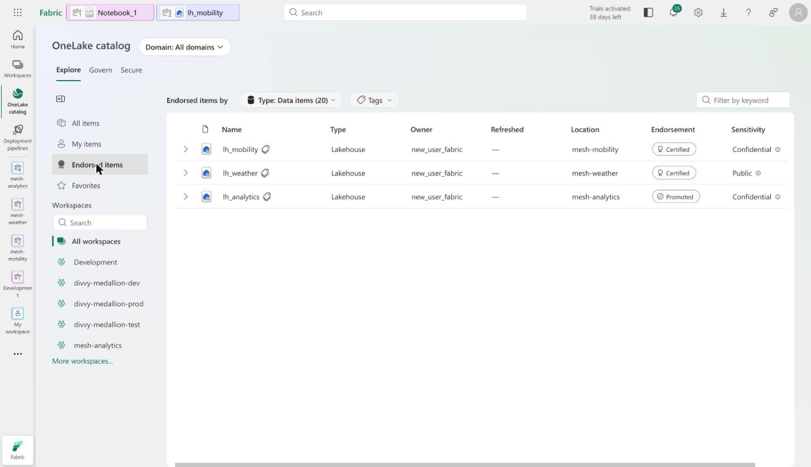 |

### Governance and security

| Domains: contributor scope and default labels | OneLake security roles across the mesh and the source |
|---|---|
| 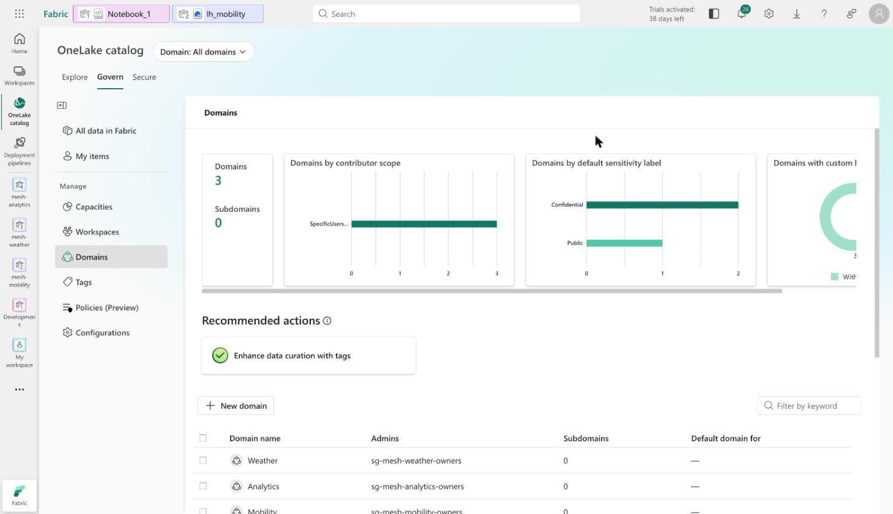 | 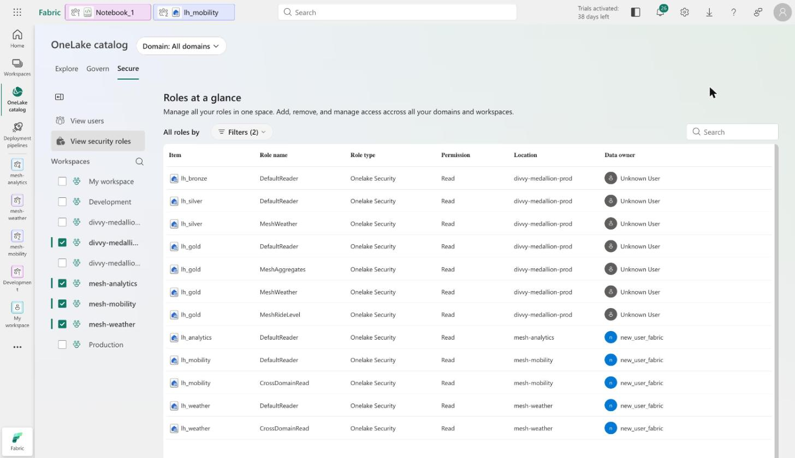 |

### Delivery

| Terraform plan posted per stack on every pull request | Apply gated by a manual approval on `platform` |
|---|---|
| 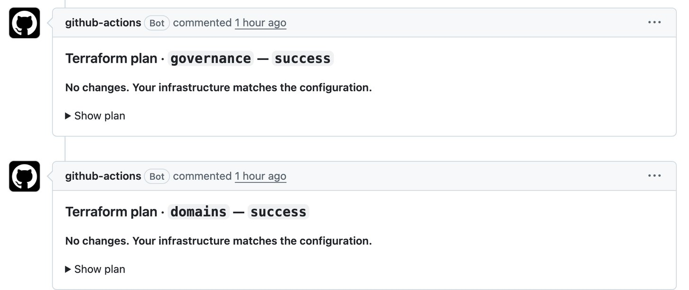 | 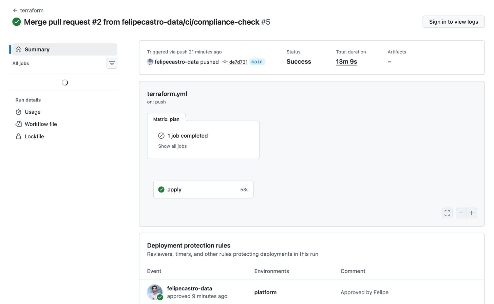 |

### Manual step: endorsement

Fabric has **no API** to promote or certify an item. Endorsement is set once in the portal: **workspace → item `…`
→ Settings → Endorsement**. Terraform still declares it (`endorsement = "Certified"`), and
`data_product_governance.py` reads it back through the scanner API. Until the portal matches, the compliance check
fails. The Mobility screenshot above shows the result.

## Tech stack

| Area | Tools |
|---|---|
| Platform | Microsoft Fabric: Domains, Lakehouse, OneLake shortcuts, OneLake security, OneLake catalog |
| Governance | Microsoft Purview Information Protection (sensitivity labels), Fabric endorsement, tags, lineage, scanner API, ODCS v3.1 data contracts |
| Identity | Microsoft Entra ID groups, service principal with GitHub OIDC federated credentials |
| Infrastructure as code | Terraform `microsoft/fabric` + `hashicorp/azuread`, HCP Terraform remote state, tflint |
| Automation | Python 3.12 package on the Fabric REST and Admin APIs (standard library; delta-rs, PyYAML and jsonschema for the contracts), uv, ruff, pytest; PowerShell for Purview labels |
| CI/CD | GitHub Actions, environments with required reviewers, protected `main`, scheduled compliance |

## Repository layout

```
infra/terraform/governance/   tenant scope: Entra groups · domains · domain roles · default labels · tags
infra/terraform/domains/      workspaces · data product lakehouses · roles · shortcuts · OneLake role map · governance outputs
src/fabric_mesh_tools/        Python package: idempotent tools for what the provider can't manage (+ OneLake reader, README charts)
tests/                        pytest on fixture JSON (no network): role diffing, change detection, access through hops
tools/purview/                Purview sensitivity labels and label policy (PowerShell)
Makefile                      make check · plan · apply
contracts/                    ODCS v3.1 data contracts, one per data product (+ the vendored ODCS JSON schema)
docs/                         design (scalability · cost · governance · security), ADRs, plan, charts, screenshots
.github/workflows/            ci (fmt · validate · tflint) · terraform (plan / apply) · compliance (drift check)
```

## Run it yourself

You need a Fabric capacity (a trial works), Microsoft Purview Information Protection (an E5 trial works), an HCP
Terraform organization, and the medallion platform from the
[sibling repo](https://github.com/felipecastro-data/fabric-medallion-cicd-terraform) as the data source.

1. Point Terraform at your HCP organization. Replace `felipecastro-data` in both stacks' `versions.tf` `cloud`
   blocks and in the `terraform_remote_state` block of `infra/terraform/domains/main.tf`. Then create the workspaces
   `fabric-mesh-governance`, `fabric-mesh-domains` (prod) and `fabric-mesh-domains-dev`, all with execution mode
   **Local**. Tag both domains workspaces `fabric-mesh-domains`, and share the governance state with them.
2. Create the CI identity: an Entra app and service principal with GitHub OIDC federated credentials (pull requests,
   `main` and the `platform` environment). Its object ID is a Terraform input from the first apply on.
3. Create the labels and label policy: `pwsh tools/purview/labels.ps1 -UserPrincipalName <admin upn>`. This applies
   them immediately and writes the label IDs to `labels.auto.tfvars.json`.
4. Enable the tenant settings: `uv run tenant-settings --apply` (needs [uv](https://docs.astral.sh/uv/)).
5. Copy each stack's `local.auto.tfvars.example` to `local.auto.tfvars` (gitignored) and fill it in:
   - `governance`: `admin_user_object_id` and `ci_service_principal_object_id`;
   - `domains`: `capacity_id`.
6. Apply `infra/terraform/governance`, then `infra/terraform/domains` per environment: `make apply ENV=dev`, then
   `make apply ENV=prod` (each applies governance, the domains stack in that environment, and the tools).
7. Set endorsement in the portal (prod only).
8. For CI:
   - set the repository variables `AZURE_CLIENT_ID`, `AZURE_TENANT_ID`, `FABRIC_CAPACITY_ID`,
     `FABRIC_ADMIN_USER_OBJECT_ID`, `FABRIC_SP_OBJECT_ID` and `SENSITIVITY_LABEL_IDS`, and the `TF_API_TOKEN` secret;
   - create the `platform` environment and add **required reviewers** to it. Without that protection rule, applies
     run without waiting for approval.

Once bootstrapped (steps 1–5), `make apply ENV=<dev|prod>` runs step 6 in CI's order, and `make check` runs ruff, pytest,
Terraform fmt/validate/tflint and every tool's dry run (`make help` lists the targets).

Progress is in [docs/PLAN.md](docs/PLAN.md). Working conventions are in [CLAUDE.md](CLAUDE.md).

## Design and decisions

- [docs/design.md](docs/design.md): scalability (onboarding domain N, shortcut depth, role limits), cost (replacing
  the trials), governance controls and the CI identity's threat model.
- Architecture decision records, each with the options considered and their trade-offs:
  - [0001](docs/adr/0001-shortcuts-vs-copied-data-products.md) data products as shortcuts, not copies
  - [0002](docs/adr/0002-two-terraform-stacks.md) two Terraform stacks: central governance and domain platform
  - [0003](docs/adr/0003-onelake-roles-via-python-upsert.md) OneLake roles through a Python upsert until the provider is fixed
  - [0004](docs/adr/0004-pr-plan-identity.md) PR plans run with the deployment identity (accepted risk)
  - [0005](docs/adr/0005-plan-file-in-git-history.md) a removed plan file stays in git history (accepted)
  - [0006](docs/adr/0006-data-contracts-odcs.md) data contracts in ODCS v3.1, checked against the live tables
  - [0007](docs/adr/0007-dev-prod-environments.md) dev → prod environments for the domains stack
  - [0008](docs/adr/0008-analytics-direct-lake-model.md) the Analytics data product is a Direct Lake semantic model

## 🏅 Author & Certifications

**Felipe Castro**
Senior Data Engineer @ EPAM Systems

- 🏅 **[DP-700: Microsoft Certified: Fabric Data Engineer Associate](https://learn.microsoft.com/api/credentials/share/en-us/FelipeCastro-8026/96572499DF943EBC?sharingId=13D660F56C1DFFA3)**
- 🏅 **[DP-600: Microsoft Certified: Fabric Analytics Engineer Associate](https://learn.microsoft.com/api/credentials/share/en-us/FelipeCastro-8026/6C5A2F5A8A5864FC?sharingId=13D660F56C1DFFA3)**
- 🏅 **[PL-300: Microsoft Certified: Power BI Data Analyst Associate](https://learn.microsoft.com/api/credentials/share/en-us/FelipeCastro-8026/F853AABE365874B3?sharingId=13D660F56C1DFFA3)**

---

## 🚀 Tools & Tech


---

## License

[MIT](LICENSE)
