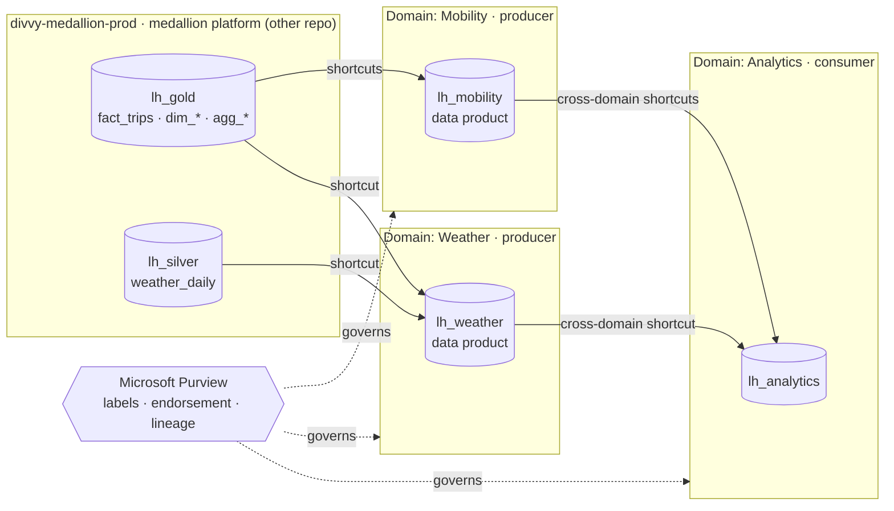

# Fabric Data Mesh — Domains · OneLake Shortcuts · Purview Governance (Terraform)

[](https://github.com/felipecastro-data/fabric-domain-architecture-purview-governance/actions/workflows/ci.yml)
[](LICENSE)

> 🚧 **Work in progress.** Progress is tracked in [docs/PLAN.md](docs/PLAN.md).

A **data-mesh architecture on Microsoft Fabric**, governed end to end and **defined entirely as code**: Fabric
**domains** own their workspaces, producer domains publish **data products** through **OneLake shortcuts** (zero
copies), a consumer domain combines them across domains, and access, classification and trust are enforced with
**OneLake data access roles**, **Microsoft Purview sensitivity labels**, **endorsement** and **lineage**.

The data products expose real Chicago Divvy bike-share trips and Open-Meteo weather produced by the sibling project
[fabric-medallion-cicd-terraform](https://github.com/felipecastro-data/fabric-medallion-cicd-terraform).

## Architecture



## Ownership model (two Terraform stacks)

| Stack | Owner | Manages |
|---|---|---|
| [`infra/terraform/governance`](infra/terraform/governance) | Central governance (Fabric admins) | Entra groups per domain, Fabric domains, domain admins/contributors, default sensitivity labels, tenant tags |
| [`infra/terraform/domains`](infra/terraform/domains) | Domain platform teams | Workspaces, data product lakehouses, workspace roles, domain assignment, OneLake shortcuts, OneLake data access roles |

## Access model

| Group (per domain) | Domain role | Workspace role | Data access |
|---|---|---|---|
| `sg-mesh-<domain>-owners` | Admin | Admin | Full |
| `sg-mesh-<domain>-engineers` | Contributor | Contributor | Full |
| `sg-mesh-<domain>-consumers` | — | Viewer | Only the tables granted by OneLake data access roles |

## Repository layout

```
infra/terraform/governance/   tenant scope: groups · domains · domain roles · tags
infra/terraform/domains/      workspaces · lakehouses · shortcuts · OneLake roles
tools/                        Purview labels (PowerShell), tenant settings, OneLake reader: what the provider cannot manage
docs/                         plan, screenshots
.github/workflows/            ci (fmt · validate · tflint)
```

## License

[MIT](LICENSE)
